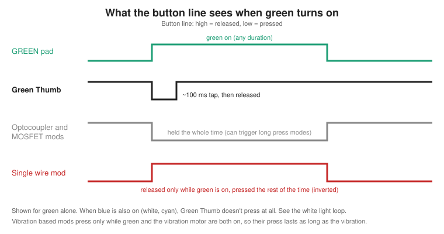
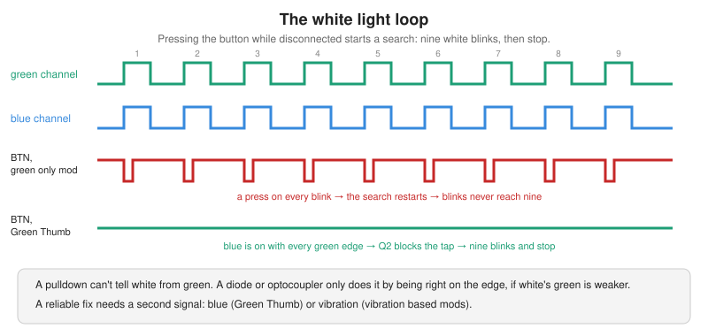
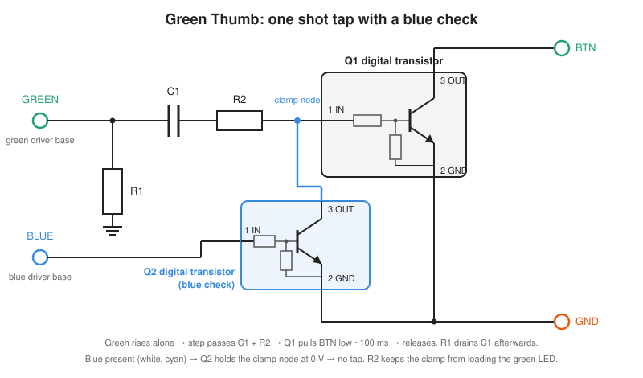

# Green Thumb

**A tiny flex PCB that presses a device's button for you when its green LED comes on — as a short tap, not a hold — and ignores white.**

<!-- TODO: add a photo of Green Thumb installed on the LED board, e.g.
<p align="center"></p>
-->

Green Thumb watches the control lines of the green and blue channels on the device's RGB LED board. When green turns on by itself, it pulls the button line to ground for about 100 ms. The device sees an ordinary button tap. When blue is on as well — white, cyan — it does nothing. The rest of the time the circuit is electrically invisible.

It exists because the popular ways of doing this either *hold* the button, which pushes the device into long-press modes, or can't tell green from white, which traps the device in an endless white-blink loop.


---

## Contents

- [What it does](#what-it-does)
- [The white-light loop](#the-white-light-loop)
- [How it compares to other mods](#how-it-compares-to-other-mods)
- [How it works](#how-it-works)
- [Installing](#installing)
- [Repository layout](#repository-layout)
- [License](#license)
- [Disclaimer](#disclaimer)

---

## What it does

| Device event | Green Thumb |
|---|---|
| Green turns on from dark | One ~100 ms button tap, within microseconds of the LED driver switching |
| Green stays on | Nothing more — the tap has already ended |
| Green turns off | Nothing |
| White or cyan (green **with** blue) | Nothing — blocked by the blue inhibit |
| Yellow (green with red, no blue) | One tap, same as green |
| Red-only or blue-only | Nothing |
| Blue turns off while green stays on (white → green) | Nothing — there's no green rising edge |
| Device idle | Nothing; draws nanoamps |
| You press the button yourself | Works exactly as stock |

Because the press is a tap, the device never sees a long hold. Because the line rests *released*, the firmware never sees a stuck button. Because white is blocked, a search pattern can't retrigger itself.

<p align="center">
  
</p>

## The white-light loop

Pressing the button while the device is disconnected starts a search, shown as **nine white blinks, then stop**. White is red + green + blue, so every one of those blinks drives the green channel exactly as a real green would. Any mod that only watches green therefore presses the button on each blink, the press restarts the search, and the device blinks white indefinitely.

<p align="center">
  
</p>

On the reference device, the same tap circuit without its blue inhibit made the white flashing endless; lifting its ground brought back nine blinks and stop. A pull-down can't fix it. Some builds report that a diode does, most likely because green is driven more weakly (PWM) during white and the diode leaves those presses just short of registering — that works on margins rather than by design. A dependable fix needs a second input. Green Thumb uses **blue**: white contains it, the green "press me" state doesn't. Other builds use **vibration**. Full write-up: [docs/white-loop.md](docs/white-loop.md).

## How it compares to other mods

| | Single wire | Opto-relay | MOSFET + pull-down | MOSFET + blue inhibit | Vibration-gated | **Green Thumb** |
|---|---|---|---|---|---|---|
| Button action | inverted hold (pressed while LED is **off**) | hold while green on | hold while green on | hold while green on, not during white | pressed while green **and** motor on | ~100 ms tap on green |
| White-light loop | likely (a press/release on every blink) | yes | yes | no | no | no |
| Long-press risk | yes | yes | yes | yes | low (vibration bursts are short) | no |
| Stuck-button error loop | yes | no | no | no | no | no |
| Idle battery drain | ~200 µA continuous | none | none | none | none | none |
| Green LED affected | back-feeds driver | often dimmed | no | no | no | no |
| Depends on vibration being on | no | no | no | no | **yes** | no |
| Works from the ~0.8 V base pad | by accident | no | marginal | marginal | marginal | yes |
| Wires to the device | 1 | 4 | 3 | 4 | 3–4 | 4 |

Each mod, its wiring and its failure modes: [docs/mod-comparison.md](docs/mod-comparison.md).

## How it works

<p align="center">
  
</p>

- **Q1, a digital transistor** (an NPN with its bias resistors built in), pulls the button line to ground. It turns on at well under a volt, and its built-in pull-down means its input can never float.
- **C1, a series capacitor**, turns a level into a pulse. A rising edge on GRN_SGNL passes through and switches Q1 on; the capacitor then charges and Q1 releases after roughly 100 ms, however long the LED stays lit. A falling edge drives the input negative, so LED-off produces no press.
- **R1, a bleed resistor**, drains C1 after each event so it's ready for the next edge.
- **Q2, a second digital transistor**, watches the blue channel. While blue is on it holds Q1's input at ground, so a green edge that arrives with blue — white, cyan — goes nowhere.
- **R2, a series resistor** between C1 and Q1, gives Q2 something to clamp against. Without it, clamping during white would make C1 charge straight from the green driver, starving it for the length of a blink: white would turn magenta. With it, the clamp costs the driver a negligible current and green stays lit.

Pads on the flex: **GRN_SGNL**, **BLU_SGNL**, **BTN**, **GND**.

Full explanation: [docs/how-it-works.md](docs/how-it-works.md).

## Installing

Short version — the full procedure with measurements is in [docs/install.md](docs/install.md):

1. Find the **green** and **blue** control pads on the LED board. Each is the base node of that channel's driver: ~0.8 V when the colour is lit, 0 V otherwise. On the reference board they sit side by side on the Side B edge, blue on the left.
2. Check that the **blue pad reads 0 V while the device shows pure green.** If it doesn't, the device mixes blue into its green and the inhibit would block every tap.
3. Find the **button pad** (~2.8 V idle, 0 V pressed) and a **ground pad** that isn't part of the antenna feed.
4. Connect GRN_SGNL, BLU_SGNL, BTN and GND.
5. Test: green state clears on its own; a press while disconnected gives nine white blinks and stops; manual presses behave as stock.

## Repository layout

```
green-thumb/
├── README.md
├── LICENSE.md               Green Thumb Hardware License
├── CHANGELOG.md
├── CONTRIBUTING.md
├── hardware/
│   └── README.md            pad list and LED-board notes
├── docs/
│   ├── how-it-works.md
│   ├── white-loop.md
│   ├── mod-comparison.md
│   ├── install.md
│   ├── testing.md
│   └── faq.md
└── images/
```

## License

Green Thumb is by **@Jackv_Makes** and is released under the **Green Thumb Hardware License v1.0** ([LICENSE.md](LICENSE.md)). In plain terms:

- Devices with Green Thumb installed may be sold, and installation may be offered as a service.
- Green Thumb boards are **not** sold or distributed as a standalone product, kit, or bare PCB — assembled or not — and the design files, bill of materials and assembly details are not published.
- This repository documents what Green Thumb does, how it works, and how it compares to other mods.

If you need something the license doesn't cover, get in touch.

## Disclaimer

This modification involves soldering to a battery-powered consumer device. It will void your warranty, and a slip can damage the device. The design is provided as-is with no warranty of any kind; see [LICENSE.md](LICENSE.md). The project is not affiliated with or endorsed by the device's manufacturer. Other community mods are described from their public posts for comparison; credit for those designs belongs to their authors.
