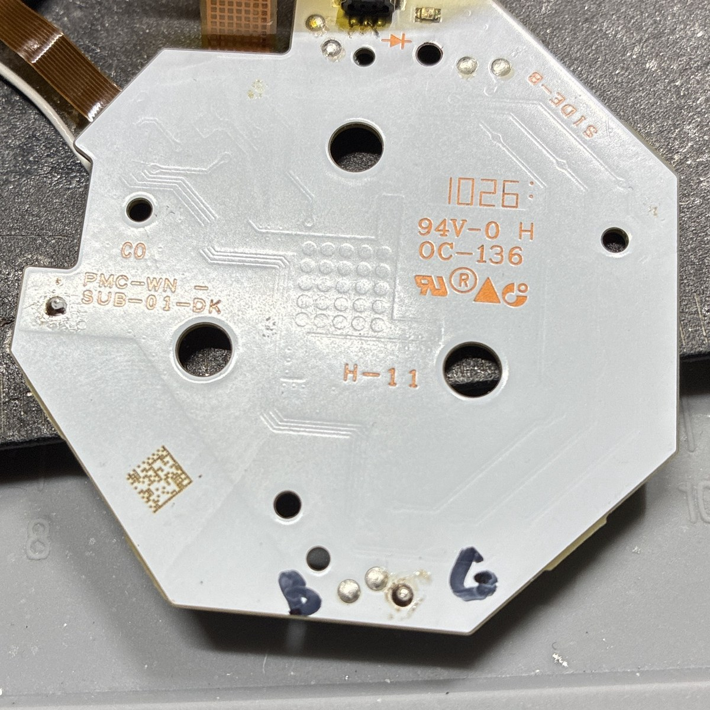
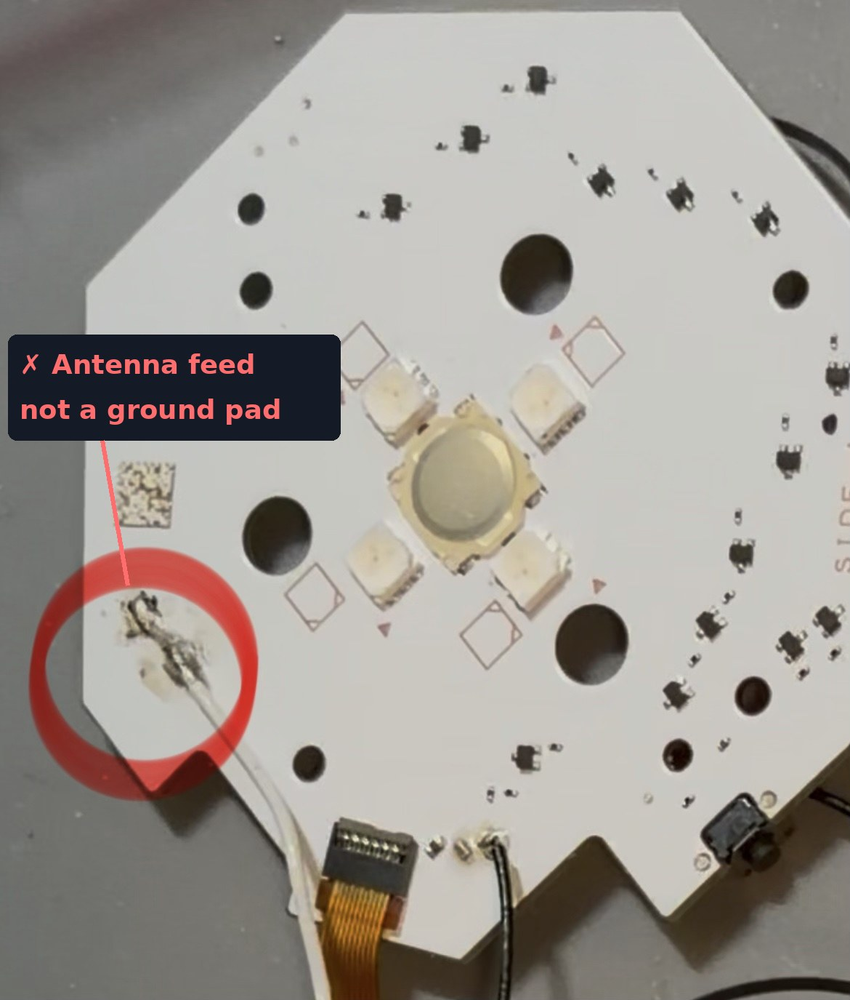

# Installation

Tools: fine-tip soldering iron, flux, fine wire, a multimeter with DC volts and continuity, a magnifier. This covers fitting an assembled Green Thumb to the device.

## 1. Confirm the device behaves the way Green Thumb expects

Power the device and get it into the state where the green LED comes on (on the reference device: three green blinks, then solid green, waiting for a press).

- **Tap** the button briefly. It should clear the state. This is what Green Thumb reproduces.
- **Hold** it for a few seconds. If the device does something different (cycles modes, powers off), that's why you want a tap.
- Tap twice in a row. If nothing bad happens, repeat taps are safe.
- With the device disconnected, press once and **count the white blinks**. On the reference device it's nine, then stop. Remember the number; it's your test for the blue inhibit.

If a tap doesn't do what you want, stop — Green Thumb won't help on this device.

## 2. Find the four connection points

**Green and blue control pads.** Each LED has a driver transistor per colour. A channel's control pad is that driver's base: **~0.8 V while the colour is lit, 0 V otherwise.** Hold the device in pure blue (on the reference device, holding the button gives blue) and in pure green, and probe until you've identified both.

On the reference board the two pads are next to each other on the Side B edge — blue on the left, green on the right as you look at Side B:

**Required check: in the pure-green state, the blue pad must read 0 V.** If it reads more than ~0.3 V, the device mixes blue into its green, and the inhibit would block every press.

**Button pad.** Steady logic high (~2.8 V) at idle, **0 V while pressed.**

**Ground.** Any pad that reads 0 V with the device on and beeps to the ribbon connector's ground pin or the u.FL shield when it's off. **Don't use the antenna feed pads** — the two pads where the white coax lands. One is the RF signal; the other, though ground, is part of the antenna tuning.

## 3. Connect the flex

<!-- TODO: photo of Green Thumb installed, pads labelled GRN_SGNL / BLU_SGNL / BTN / GND -->

| Flex pad | Wire to |
|---|---|
| GRN_SGNL | green control pad |
| BLU_SGNL | blue control pad |
| BTN | button line |
| GND | ground pad |

Keep the wires short. Tack the flex down with a dot of UV mask or double-sided tape so nothing flexes at the solder joints. Don't swap GRN_SGNL and BLU_SGNL — with them reversed, green would inhibit itself and nothing would ever press.

## 4. Test

1. Device off, continuity: GRN_SGNL ↔ green driver base only; BLU_SGNL ↔ blue driver base only; BTN ↔ button line; GND ↔ ground.
2. Power on. The device boots normally. Press the button by hand; it works as before, tap and hold.
3. Trigger the green state. It clears on its own, typically on the first blink. A faint green flicker is normal.
4. Disconnect, press once. **Nine white blinks (or whatever you counted in step 1), then stop**, and the colour stays white — not magenta, not yellow.
5. Watch a few cycles of normal use: a tap per green-from-dark, nothing on red, blue or white, no stuck states.

If anything is off, see [testing.md](testing.md).
