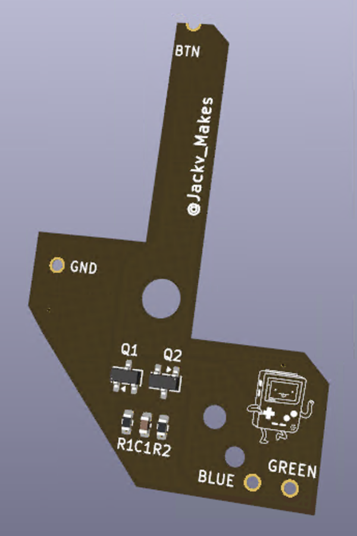

# Installation

Installing Green Thumb is just soldering its four pads to the matching points on the LED board. Nothing else on the Plus+ gets modified.

| Flex pad | Solders to |
|---|---|
| GREEN | green control point |
| BLUE | blue control point |
| BTN | button point |
| GND | ground point |

1. Line up the flex so each pad sits over its point.
2. Solder the four pads.
3. Make sure there aren't any solder bridges between pads that are close together.

Then check out [testing.md](testing.md) to make sure it's working.

Here is a Youtube video that you can watch as somewhat of a guide: [Green Thumb Installation](https://youtu.be/2Xi1ZRyPdPE)
